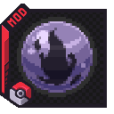

 

# Cobblemon: Shadowed Hearts

Shadowed Hearts brings the Shadow Pokémon of *Pokémon Colosseum* and *Pokémon XD: Gale of Darkness* into Cobblemon. A Shadow Pokémon can battle alongside you while its heart is closed. As you open its heart, it regains access to its ordinary moves and gets closer to purification.

**Download** · [CurseForge](https://www.curseforge.com/minecraft/mc-mods/cobblemon-shadowed-hearts) · [Modrinth](https://modrinth.com/mod/cobblemon-shadowedhearts)

## Getting started

Choose the download for your Minecraft version and mod loader, and install the dependencies listed for that release. For multiplayer, install matching versions of Shadowed Hearts and its required mods on the server and on each player's client.

Use an **Aura Reader** to find a wild Shadow Pokémon. You can catch it with a regular Poké Ball. To rescue one from an eligible NPC trainer, equip a **Snag Machine**.

Once you have a Shadow Pokémon of your own, walk with it in your party, battle together, or use scents to lower its Heart Gauge. When the gauge reaches zero, send it out beside a **Relic Stone** and interact with the stone to purify it. [Player wiki](https://github.com/JayemCeekay/shadowedhearts/wiki)

## Modpack and server permissions

You're welcome to run Shadowed Hearts on public or private servers and include it in public or private modpacks. Download official releases through CurseForge or Modrinth. For a published pack, reference the official file in your pack manifest so the launcher downloads it from the project page.

Ask JayemCeekay before redistributing a JAR yourself, including bundling it in a client or server pack ZIP or hosting a mirror. You can request permission through the [issue tracker](https://github.com/JayemCeekay/shadowedhearts/issues). All other rights are reserved under the [project license](LICENSE.txt).

## Contributing

Bug reports, gameplay feedback, translations, and code contributions are welcome. The [contributing guide](CONTRIBUTING.md) covers reporting an issue, building the mod, and submitting a pull request.

## Credits

| Contributor | Contribution |
| --- | --- |
| JayemCeekay | Creator and maintainer |
| KorytheMaril | Textures and ideas |
| xone | Models and textures |
| Eag | Models and textures |
| Nolram | Sound Assets |
| JuneCPU | Sound Assets |
| Urkaz | Performance and synchronization improvements |
| ubergeek77 | Fixed a rendering issue on the Purification Chamber model |

Thanks to the Cobblemon team for the Pokémon and battle systems this mod builds on.
